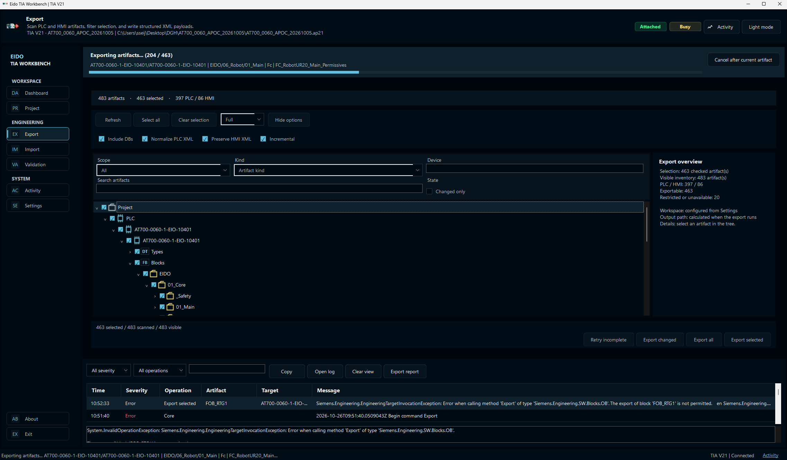

# Eido TIA Workbench

Copyright (c) 2026 EIDO AUTOMATION, S.L.U.

WinForms engineering workspace with **offline validation** and an isolated **TIA Portal V21 adapter**.

The desktop and Core no longer load or reference Siemens assemblies. Engineering
commands run in a separate .NET Framework 4.8 x64 worker. The application opens
without Openness installed; Settings provides installation discovery, automatic or
manual selection, custom paths and capability diagnostics.

V17–V20 are recognized by discovery but **have no implemented adapter**. They are
not advertised as supported. See the [compatibility matrix and limitations](docs/Modernization.md).



*Export in progress with the current artifact, completed-item count, cooperative
cancellation and Activity diagnostics visible in the same workspace. Individual
export restrictions are recorded per artifact; the screenshot shows an ongoing
operation, not a completed or error-free run.*

## Recent improvements

- **Responsive operation feedback:** a single progress panel shows the phase,
  item count and current artifact. Navigation and Activity tools remain available
  during export/import; visual updates are batched to reduce UI work.
- **Project identity checks:** changing or losing the project invalidates the scan.
  Export verifies the scanned project again before processing artifacts. V21
  project paths are read from the API's `FileInfo` value.
- **Incremental integrity:** repositories record their source project path. The
  primary payload hash is checked against the actual file; local modifications
  produce a conflict. Missing or empty declared payloads prevent unchanged skips.
- **Explicit validation failures:** corrupt manifests and missing declared files
  are reported. Import preflight checks the selected target version; an unknown
  target produces a compatibility warning.
- **Worker recovery and IPC:** request IDs correlate commands, progress, results
  and cancellation. Observer failures do not desynchronize replies, and an exited
  worker no longer leaves the UI reporting an open portal.
- **EIDO code style:** updated formatting, XML documentation and programming guide,
  backed by strict build checks and regression tests.

See the [audit and correction record](docs/AUDIT_2026-10-26.md) for evidence,
remaining limitations and the distinction between offline tests and live TIA
acceptance.

## Requirements and build

Windows, .NET Framework 4.8 and x64. Build with Visual Studio/MSBuild and restore
StyleCop.Analyzers. The full solution requires the local V21 SDK; only Core and
OfflineTests can be built without Siemens.

```powershell
msbuild EidoTiaWorkbench.slnx /restore /p:Configuration=Release /p:Platform=x64
msbuild EidoTiaWorkbench.OfflineTests/EidoTiaWorkbench.OfflineTests.csproj /restore /p:Configuration=Debug /p:Platform=x64
```

For nonstandard build installations set `/p:OpennessV21Path=<PublicAPI V21 net48 path>`.
Deploy EIDO's Desktop, Core, Worker and Openness.V21 outputs together. **Never copy
or redistribute Siemens DLLs.** All proprietary references retain `Private=False`.
Client, Core and worker must be updated together: IPC protocol 2 rejects older
protocol versions.

## Runtime selection

Settings → TIA Portal Integration reads both Windows registry views under
`HKLM\SOFTWARE\Siemens\Automation\Openness`, standard installation paths,
a custom directory and `TIA_OPENNESS`. `TIA_OPENNESS_V21` remains a deprecated
fallback. Assembly identity validation and worker loading precede engineering work.
Automatic selects the highest implemented adapter. An unavailable manual choice
stays offline; it never silently connects with another version. Disconnect and
finish all work before changing the selected runtime.

An installation being detected does not certify permissions or project compatibility.
The [architecture and verification record](docs/Modernization.md) distinguishes those states.
The [corporate C# guide](docs/EIDO_CSharp_Programming_Style_Guide_v1.0.md) defines coding rules.

## Repository Layout

PLC artifacts are exported below:

```text
PLC/<Device>/<CPU>/<Category>/<GroupPath>/<Name>__<hash>.<format>
```

Classic HMI artifacts are exported below:

```text
HMI/<Device>/<HMI target>/<Category>/<FolderPath>/<Name>.xml
```

Current categories include `Blocks`, `Types`, `TagTables`, `WatchTables`, `ForceTables`, `UserConstants`, `TechnologyObjects`, `Screens`, `Templates`, `Popups`, `SlideIns`, `Tags`, `Connections`, `TextLists`, `GraphicLists`, `Cycles`, `Scripts`, `GlobalElements`, and `ScreenOverview`.

PLC XML can be normalized for deterministic diffs. HMI screen XML is preserved by default because the Openness WinCC screen XML is the safe reimport format.

## Usage

1. Start TIA Portal V21 or let Eido TIA Workbench start it.
2. Open or select a TIA project.
3. Scan PLC artifacts and classic HMI artifacts.
4. Export selected items or all items to the chosen repository folder.
5. Import selected repository artifacts back into the open project when needed. Existing PLC and HMI artifacts require an explicit Skip or Replace decision. Ask blocks replacement until resolved. Enabled backups must complete before replacement.

Long-running commands share one operation state model. The progress panel shows
the current phase, artifact and completed-item count, with indeterminate progress
when the total is unknown. Navigation, Activity filters, log copying and opening
the log remain available. Incompatible engineering commands stay disabled until
the current operation ends. The redundant status-bar progress indicator has been
removed.

Import always runs a local preflight before calling Siemens Openness. Preflight checks repository state, manifest consistency, XML well-formedness, duplicate IDs, common missing ID/reference problems, unsupported artifacts, and dependency-plan issues. Dry run is non-destructive and intentionally reports simulated actions only; it does not claim Siemens XML import compatibility until a real import calls Openness.

Import selection defaults to `New`, `Modified`, and `Conflict` repository artifacts. `Identical` artifacts are left unchecked.

Cancellation is cooperative: it prevents new artifact work between items and
waits for the active Siemens call to finish. The interface remains available for
inspection while cancellation is pending; another engineering operation cannot
start until cleanup completes.

Exports written by the tool include `meta/tia.txt`, `meta/manifest.json`, and `meta/operation-report.txt`.

`manifest.json` schema version 3 is an execution inventory, not just a list of successful payloads. It contains one entry per scanned artifact, including `Unavailable`, `Restricted`, `Failed`, `AbortedSessionLost`, `Cancelled`, and `SkippedUnchanged` items. Entries without payload keep empty `PrimaryPath`, `Files`, and hash fields while preserving the final status and reason.

Export runs finish with one of five global states: `Completed`, `CompletedWithIssues`, `Aborted`, `Cancelled`, or `Failed`. Artifact-level issues such as protected PLC blocks, unsupported API gaps, and isolated HMI GraphicList export errors are recorded per artifact so the remaining queue can continue when the TIA session is still valid.

If a TIA Portal project/session appears lost during export, the exporter makes one controlled recovery attempt. Recovery revalidates or reattaches the portal, adopts only the matching project by the captured project name/path, and resolves later artifacts again by `LogicalKey` instead of reusing old Openness references. Only confirmed unrecovered session loss marks remaining artifacts as `AbortedSessionLost`.

### Incremental repository compatibility

An existing incremental repository must have a verified project identity in its
manifest. For older repositories without that identity, create a full export or
select a new destination. The application does not infer ownership from matching
project names. Primary files are checked by SHA-256; auxiliary files are checked
for existence and nonzero size, without individual content hashes.

## Tests and Visual Validation

The solution includes `EidoTiaWorkbench.Tests`, an offline .NET Framework 4.8 x64 console test runner for path layout, catalog/adapter consistency, manifest round-trips, no-payload entries, retry selection, repository inventory parsing, schema 3 manifest lookup, multi-format payloads, compound manifest payloads, invalid XML detection, import preflight, dependency ordering, exception diagnostics, hashing, export preflight, GraphicList failure isolation, session-loss policy, safe STA cancellation, state classification, transactional payload preservation, anonymized coverage-regression counts, and import conflict policy stability.

Run tests after a Debug build:

```powershell
.\EidoTiaWorkbench.Tests\bin\x64\Debug\EidoTiaWorkbench.Tests.exe
```

The current regression runner contains **35 tests**, passing in both Debug and
Release. Additional audit regressions run through the visual-validation tool,
covering repository failures, project identity, IPC observer failures and worker
exit without opening a Siemens project.

```powershell
.\tools\Test-EidoStyle.ps1
.\EidoTiaWorkbench.OfflineTests\bin\x64\Debug\EidoTiaWorkbench.OfflineTests.exe
.\tools\Test-VisualLayout.ps1 -Configuration Release
```

The style check validates EIDO headers and formatting and builds Debug and Release
with warnings treated as errors. Visual checks produce 24 page renders plus eight
busy-operation renders under `artifacts/validation/redesign-shell`. They simulate
export/import with bursts of activity messages and check progress-text layout,
Activity access and removal of the duplicate progress bar at 100–200% scale.
Native Windows DPI and live project round-trips remain separate manual acceptance
checks.

## Contributing and License

See `CONTRIBUTING.md` for setup, style, validation, and Siemens-data handling guidelines.

Eido TIA Workbench is released under the MIT License. See `LICENSE`.
